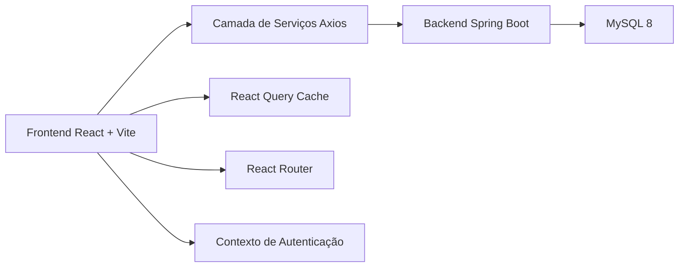
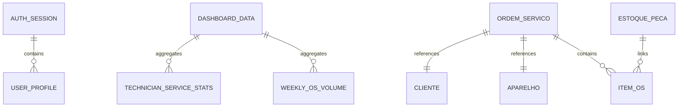

## 1. Desenho de Arquitetura



## 2. Descrição da Tecnologia
- Frontend: React 18 + Vite + TailwindCSS + React Router v6
- Estado servidor: TanStack Query
- HTTP Client: Axios com interceptor para JWT e tratamento centralizado de erro
- Formulários: React Hook Form + Zod
- Gráficos: Recharts
- Ícones: Lucide React
- Backend consumido: Spring Boot 3 já implementado no módulo [backend](file:///c:/Users/Administrator/Documents/projeto%20assistencia%20Gtech/backend)

## 3. Definição de Rotas
| Rota | Objetivo |
|-------|---------|
| /login | Tela de autenticação |
| / | Redirecionamento para dashboard |
| /dashboard | Painel administrativo |
| /clientes | Gestão de clientes |
| /ordens-servico | Listagem de OS |
| /ordens-servico/nova | Abertura de OS em múltiplos passos |
| /estoque | Listagem e controle de peças |

## 4. Definição de APIs Consumidas

### 4.1 Autenticação
```ts
type LoginRequest = {
  username: string;
  password: string;
};

type LoginResponse = {
  accessToken: string;
  tokenType: string;
  expiresIn: number;
  username: string;
  perfil: string;
};
```

### 4.2 Clientes
```ts
type ClienteRequest = {
  nome: string;
  cpfCnpj: string;
  email?: string;
  telefone: string;
  logradouro?: string;
  numero?: string;
  bairro?: string;
  cidade?: string;
  uf?: string;
  cep?: string;
};

type ClienteResponse = ClienteRequest & {
  id: number;
};
```

### 4.3 Ordens de Serviço
```ts
type OrdemServicoRequest = {
  cliente: {
    id?: number;
    nome: string;
    cpfCnpj: string;
    email?: string;
    telefone: string;
    logradouro?: string;
    numero?: string;
    bairro?: string;
    cidade?: string;
    uf?: string;
    cep?: string;
  };
  aparelho: {
    marca: string;
    modelo: string;
    cor?: string;
    imei: string;
    numeroSerie?: string;
    bloqueioConta: boolean;
    bloqueioFrp: boolean;
    observacoes?: string;
  };
  checklist: {
    tela: string;
    carcaca: string;
    botoes: string;
    conectores: string;
    cameras?: string;
    biometria?: string;
    oxidacao: boolean;
  };
  acessoriosRecebidos?: string;
  problemaRelatado: string;
  imeiConfirmado: string;
  senhaDispositivo?: string;
  tecnicoId?: number;
  itensPecas: Array<{
    estoquePecaId?: number;
    descricao: string;
    quantidade: number;
    valorUnitario: number;
  }>;
};

type OrdemServicoResponse = {
  id: number;
  codigo: string;
  status: string;
  clienteId: number;
  aparelhoId: number;
  atendenteId: number;
  tecnicoId?: number;
  clienteNome: string;
  aparelhoDescricao: string;
  valorPecas: number;
  valorMaoObra: number;
  desconto: number;
  valorTotal: number;
  dataEntrada: string;
  version: number;
  itens: Array<{
    id: number;
    estoquePecaId?: number;
    descricao: string;
    quantidade: number;
    valorUnitario: number;
    subtotal: number;
  }>;
};
```

### 4.4 Estoque
```ts
type EstoquePecaResponse = {
  id: number;
  sku: string;
  nome: string;
  descricao?: string;
  unidadeMedida: string;
  custoMedio: number;
  precoVenda: number;
  quantidadeAtual: number;
  estoqueMinimo: number;
  ativo: boolean;
  version: number;
};
```

## 5. Arquitetura da Camada Frontend
O frontend seguirá uma estrutura modular por responsabilidade:
- `components`: componentes visuais reutilizáveis
- `pages`: páginas mapeadas por rota
- `services`: cliente Axios e serviços por domínio
- `hooks`: hooks customizados com React Query
- `contexts`: autenticação e sessão
- `layouts`: shell principal com sidebar e cabeçalho
- `styles`: Tailwind base e tokens visuais
- `types`: contratos reutilizáveis de dados

## 6. Modelo de Dados do Frontend
### 6.1 Modelo de Estado



### 6.2 Convenções Técnicas
- O token JWT será salvo inicialmente em `localStorage` para acelerar integração com o backend atual.
- O interceptor Axios injeta o token em todas as rotas autenticadas.
- Respostas `401` removem sessão local e redirecionam para `/login`.
- Protected Routes serão implementadas com `Outlet` e verificação de sessão.
- As telas usarão React Query para sincronização, invalidação de cache e estados de loading/erro.
