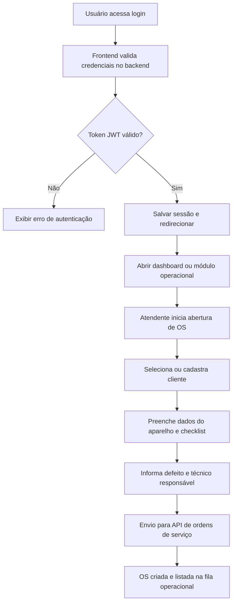

## 1. Visão Geral do Produto
Plataforma web para operação de assistência técnica de celulares e eletrônicos, conectada ao backend Spring Boot já implementado, com foco em produtividade operacional, clareza visual e segurança de acesso.
- O frontend deve reduzir tempo de atendimento, facilitar abertura de OS e tornar indicadores operacionais compreensíveis para atendentes, técnicos e gestores.
- O valor do produto está em transformar uma operação técnica complexa em um fluxo visual simples, rápido e rastreável.

## 2. Funcionalidades Principais

### 2.1 Papéis de Usuário
| Papel | Método de acesso | Permissões centrais |
|------|------------------|---------------------|
| Administrador | Login com JWT | Acesso total ao dashboard, clientes, estoque e ordens de serviço |
| Atendente | Login com JWT | Cadastro de clientes, abertura de OS, consulta operacional |
| Técnico | Login com JWT | Consulta de OS, atualização de status, leitura operacional limitada |

### 2.2 Módulos Funcionais
1. **Login**: autenticação com JWT, persistência de sessão e redirecionamento seguro.
2. **Dashboard Administrativo**: indicadores operacionais, gráficos e visão rápida da operação.
3. **Ordens de Serviço**: listagem, filtros, visualização de detalhes e formulário de abertura de OS em múltiplos passos.
4. **Clientes**: cadastro, busca e atualização de dados cadastrais.
5. **Estoque**: consulta de peças, alertas de estoque mínimo e ajustes operacionais.

### 2.3 Detalhamento das Páginas
| Nome da Página | Módulo | Descrição funcional |
|-----------|-------------|---------------------|
| Login | Formulário de autenticação | Recebe usuário e senha, chama backend, armazena token e redireciona conforme sessão válida |
| Dashboard | Cards de indicadores | Exibe OS em aberto, faturamento do dia, aparelhos pendentes e atalhos operacionais |
| Dashboard | Gráfico por técnico | Mostra volume de serviços por técnico em gráfico de barras |
| Dashboard | Gráfico semanal | Mostra volume de OS na semana em gráfico de linha ou área |
| Ordens de Serviço | Lista de OS | Exibe OS com filtros por status, cliente e código |
| Ordens de Serviço | Formulário multi-step | Permite criar OS por etapas: cliente, aparelho/checklist, defeito/técnico |
| Clientes | Cadastro e busca | Permite registrar e consultar clientes rapidamente |
| Estoque | Lista de peças | Exibe peças, saldo atual, mínimo e alertas visuais |
| Estoque | Ajuste de estoque | Permite entrada, saída e correções de saldo por usuários autorizados |

## 3. Fluxo Principal
Fluxo principal do usuário atendente: autentica no sistema, localiza ou cadastra cliente, abre a OS com informações do aparelho e checklist, salva a ordem e acompanha o andamento operacional. Fluxo do gestor: acessa o dashboard, monitora indicadores e consulta filas operacionais. Fluxo do técnico: lista OS atribuídas, consulta dados do aparelho e atualiza o status conforme o reparo avança.

## 4. Design de Interface
### 4.1 Estilo Visual
- Cores primárias: azul petróleo, cinza grafite, branco gelo e verde de ação para estados de sucesso.
- Cores secundárias: âmbar para alertas, vermelho controlado para erros e azul claro para destaque informacional.
- Botões: cantos médios, tipografia forte, contraste alto e estados de hover claros.
- Tipografia: fonte sem serifa moderna para leitura operacional, com hierarquia forte em títulos e métricas.
- Layout: desktop-first com sidebar lateral fixa, topo enxuto e blocos em cards modulares.
- Ícones: Lucide React com uso objetivo para navegação, métricas e estados.

### 4.2 Visão de Design das Páginas
| Página | Módulo | Elementos de UI |
|-----------|-------------|-------------|
| Login | Formulário principal | Card central, campos grandes, feedback de erro claro, branding discreto |
| Dashboard | Cards de resumo | Cards responsivos com ícone, métrica, subtítulo e tendência |
| Dashboard | Gráficos | Blocos amplos com títulos, legenda simples e leitura imediata |
| OS | Formulário multi-step | Stepper superior, campos agrupados, checklist em grade visual, validação inline |
| OS | Lista | Tabela com filtros, badges de status, ações rápidas e destaque por criticidade |
| Clientes | Busca e cadastro | Formulário objetivo, listagem simples, foco em velocidade operacional |
| Estoque | Tabela e alertas | Tabela com destaque de saldo baixo, filtros e botões de ajuste |

### 4.3 Responsividade
- Estratégia desktop-first para uso principal em balcão e gestão.
- Adaptação para tablets com sidebar colapsável e blocos empilháveis.
- Em telas menores, formulários passam a fluxo vertical e gráficos ocupam largura total.
- Elementos interativos devem manter áreas clicáveis amplas e leitura confortável.
